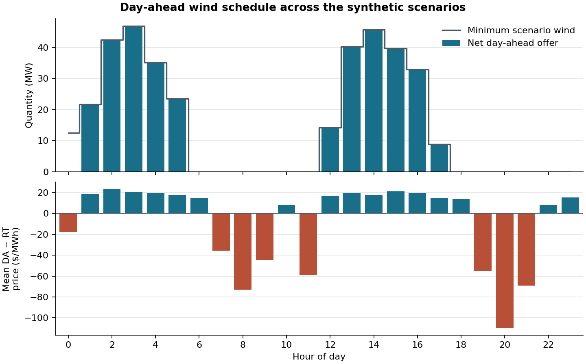

# Day-Ahead Bidding for Wind Power

By: Efosa Osazuwa

How much wind generation should you schedule day-ahead when both prices and production are uncertain? This Pyomo model chooses one schedule for a 24-hour day and maximizes expected revenue across 100 equally weighted synthetic scenarios.

## Worked example

The model averages **$46,781** per scenario day, compared with **$39,899** for selling all wind generation at real-time prices. That is a **17.25% increase in modeled revenue** across the scenarios used to solve the schedule.



The teal bars show the net day-ahead offer, equal to the offer minus the buyback quantity. The model schedules a net offer when the average day-ahead price exceeds the average real-time price and every scenario has wind available. The lowest wind forecast caps the offer for that hour.

## Run the example

From the repository root, use Python 3.11, [uv](https://docs.astral.sh/uv/), and [GLPK](https://pyomo.readthedocs.io/en/stable/getting_started/solvers.html). Install GLPK with `brew install glpk` on macOS or `sudo apt install glpk-utils` on Debian and Ubuntu. Confirm that `glpsol` is on your `PATH`.

```sh
uv run --locked --python 3.11 -m energy_optimization.example
```

The command reads the [tracked scenario data](data/energy_market_samples.npz), prints both revenue figures, and regenerates the chart. Pass `--output path/to/chart.png` to save it elsewhere. The [analysis notebook](data_analysis.ipynb) shows the individual wind and price scenarios.

```sh
uv run --locked --extra dev --python 3.11 -m pytest -q
```

## Model formulation

The model uses one set of hourly bid and offer decisions across the scenarios. Each interval lasts one hour, so the numeric MW quantity corresponds to the same number of MWh in settlement.

### Sets & Indices

- $T$  : Set of time periods (hours in a single day)
-  $S$  : Set of scenarios

### Parameters

-  $\text{DAPrice}_{s,t}$  : Day-ahead market price at time $t$, scenario $s$  ($/MWh)
-  $\text{RTPrice}_{s,t}$  : Real-time market price at time $t$, scenario $s$ ($/MWh)
-  $\text{WindGen}_{s,t}$  : Wind power generation at time $t$, scenario $s$ (MW)

### Decision Variables

- $\text{OfferQuantity}_{t}$ : Energy offered in the market at time $t$
- $\text{BidQuantity}_{t}$ : Energy bid in the market at time $t$
- $\text{OfferPrice}_{t}$ : Offer price at time $t$ ($/MWh)
- $\text{BidPrice}_{t}$ : Bid price at time $t$ ($/MWh)

### Objective

**Maximize total expected revenue**

```math
\max \frac{1}{\text{NumScenarios}} \sum_{s \in S} \sum_{t \in T} \Big( \text{OfferQuantity}_t \cdot (\text{DAPrice}_{s,t} - \text{RTPrice}_{s,t}) + \text{BidQuantity}_t \cdot (\text{RTPrice}_{s,t} - \text{DAPrice}_{s,t}) + \text{WindGen}_{s,t} \cdot \text{RTPrice}_{s,t} \Big)
```

### Constraints

1. **Offer Quantity Constraint:**
   ```math
   \text{OfferQuantity}_{t} \leq \text{WindGen}_{s, t} \quad \forall t \in T, s \in S
   ```

2. **Bid Quantity Constraint:**
   ```math
    \text{BidQuantity}_{t} \leq \text{OfferQuantity}_{t}, \quad \forall t \in T
   ```

3. **Offer(Sell) Market Participation Constraint:**
   ```math
   \text{OfferPrice}_{t} \geq \text{DAPrice}_{s,t}, \quad \forall t \in T, s \in S
   ```

4. **Bid(Buy) Market Participation Constraint:**
   ```math
   \text{BidPrice}_{t} \leq \text{DAPrice}_{s,t}, \quad \forall t \in T, s \in S
   ```

The revenue expression applies the scheduled quantities in every scenario. It has no scenario-specific cleared volumes, and the bid and offer prices enter only the constraints. The reported increase is an in-sample comparison of expected revenue.
